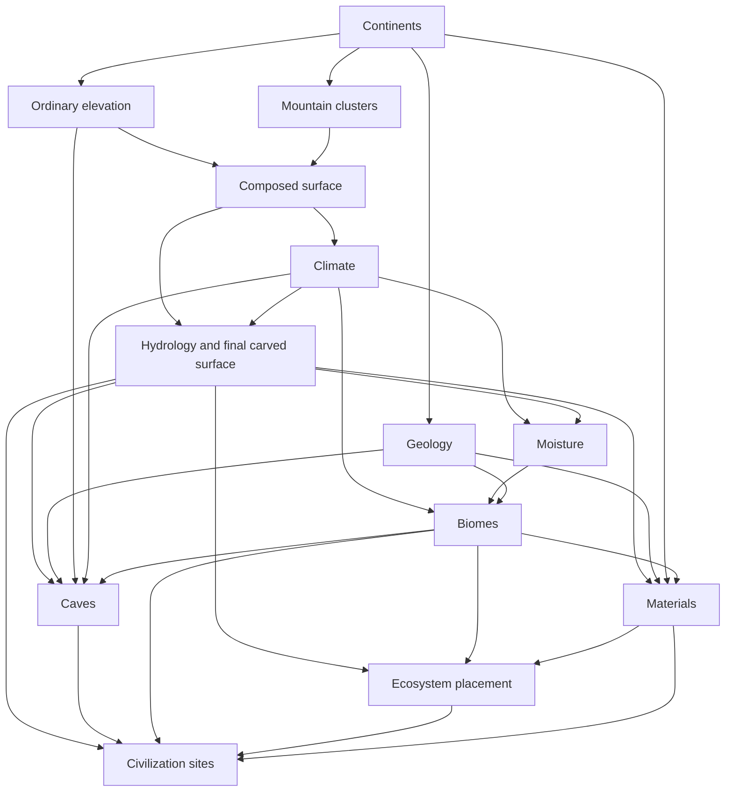
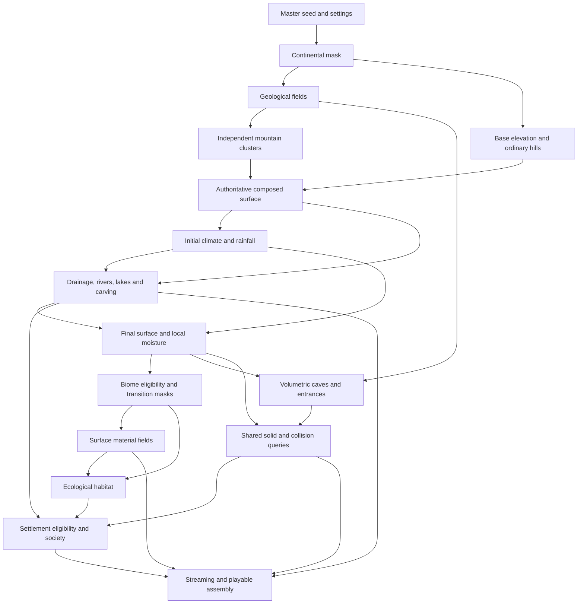

# Alpha v0.0.11 — world refinement architecture

The preserved [request](Validation/Alpha-v0.0.11/requirements.txt) makes physical geography, modular authority, mountain/hydrology appearance and reliable generation the primary gates. Convenience controls and settlement/NPC additions follow those gates. No new literary Chronicle will be generated.

## Implemented module graph

Generator10 / world schema8 records every module ID, version and derived seed. The executable composition is in `Assets/Scripts/World/ProceduralGeography.cs`; `WorldGenerationPipeline` checks typed dependencies before publishing immutable products. Hydrology, caves, materials, ecosystem and founding-site fields receive typed upstream products. They do not retain a geography facade.

| Product | Version | Direct upstream products |
| --- | --- | --- |
| Continents | 3 | Master seed/settings |
| Geology | 6 | Continents |
| Ordinary elevation | 3 | Continents |
| Mountain clusters | 6 | Continents |
| Composed surface | 1 | Ordinary elevation, mountains |
| Climate | 5 | Composed surface |
| Hydrology | 12 | Composed surface, climate |
| Moisture | 1 | Climate, hydrology |
| Biomes | 2 | Climate, moisture, geology |
| Caves | 2 | Hydrology, geology, ordinary elevation, climate, completed biomes |
| Materials | 1 | Hydrology, geology, continents, biomes |
| Ecosystem placement | 1 | Hydrology, biomes, materials |
| Civilization sites | 1 | Hydrology, caves, biomes, ecosystem placement, materials |

Hydrology publishes final carved terrain and layout8 water geometry only after drainage settles; climate never reads its downstream moisture reconciliation. Cave density and excavation modify the shared solid field. Rendering/collision use canonical triangles and preserve persistent edits. Camera streaming cannot create aggregate population or resources.

The separate saved simulation models are ecology3 and civilization2. Ecology3 supports biomass in eligible cold moist boreal regions; tundra/snow/desert exclusions remain. Civilization2 stores real dwelling capacity, paid construction, resident identities/health/deaths and geographic physical poses. A bounded representative subset walks shared paths near the observer. Health/death affect authoritative population, while local pose presentation does not control the aggregate economy. Old versions require preserved matching builds; no silent migration occurs.

Generation diagnostics record per-module elapsed work and heartbeat/substep progress. Ten immutable129-square snapshots show completed outputs during loading; application assembly contributes four further progress stages. Seed and module identities remain fixed when display preferences change.

## Historical baseline audit

The v0.0.9 and v0.0.10 authored source/runtime preservation records were verified before changes. Existing generated `obj` drift in the older archive is already recorded; the v0.0.10 source package excludes generated caches. See [baseline preservation](Validation/Alpha-v0.0.11/baseline-preservation.json). User saves remain untouched.

| System | Current authority | Decision |
| --- | --- | --- |
| Continents | Calibrated continuous continental field and plate descriptors in `GeologyMap` | Retain deterministic mask ideas; extract an independently inspectable product |
| Elevation / mountains | Regional 257² geological height field plus analytic noise; broad uplift, plateaus and mountain shaping share one class | Separate ordinary elevation from dedicated cluster descriptors; compose one physical surface |
| Climate / biomes | Independent 129² rain/ocean-distance fields; altitude/latitude query and biome classification combined in `ClimateMap.Sample` | Retain transport foundations; separate climate data, hydrological moisture reconciliation and biome classification |
| Hydrology | 1025² priority flood, discharge/receivers, sampled river paths, repeated basin refinement and final meshes | Preserve useful topology; replace uncontrolled refinement feedback with explicit bounded work and diagnostics, then repair physical/visual network quality |
| Caves / solids | Analytic regional cave networks, local volumetric collision, persistent excavation | Retain solid authority and saved edits; improve surface integration and practical discovery |
| Rendering | Streamed surface meshes, regional/planetary LOD, separate water surfaces, horizontal rebasing | Retain bounded streaming; diagnose material/depth/shoreline disagreement from moving native views |
| Ecology / society | Bounded regional ecology and aggregate civilizations, paid construction, persistent inventories/history | Preserve their authority; consume completed geographic outputs through explicit contracts |
| Loading | Three immutable 65² previews; callback strings mapped to ten UI stages; async creation/installation | Replace coarse label-only reporting with module/substep diagnostics and authentic completed-layer previews |
| Archives | Generator 9 / geology 4 / hydrology 9 / climate 3 / caves 1 / schema 7 | Keep matching old players. New geography receives a new generator identity and explicit module-version contract |

The existing constructor already sequences several separate maps, but it is not a dependency-checked generation pipeline. Climate is queried again while hydrology mutates; biome eligibility is computed on demand inside climate; mountain shape is entangled with broad elevation. The outer drainage loop has cycle detection but no explicit pass/time budget or useful per-basin heartbeat. The existing timing named `HydrologyMilliseconds` stops before basin refinement and water triangulation, so it does not represent total water-generation work.

Normal project settings have `runInBackground: 0`. Loading resumes through Unity's main-thread synchronization context after worker tasks. An unfocused main loop can therefore leave a frozen stage label after worker work finishes. This is a verified mechanism and a test target, **not a confirmed diagnosis of the user's reported incident**. No stalled process remained running to inspect. The exact incident seed is not yet established.

## Historical proposed dependency contracts

Every computation has a stable ID/version, declared inputs, typed output, derived seed, cancellation and bounded diagnostics. Independent modules use distinct seed streams; scheduling order cannot consume another module's randomness. Data fields are not redundant visible meshes. The final surface is one elevation authority; cave density modifies solids, and water surfaces reference the same drainage/carving result.

The first implementation step is a checked orchestration/data contract and generation diagnostics. Adapters are transitional: moving the old constructor under new labels alone does not satisfy the requested modular reconstruction. Mountain and hydrology algorithm replacements must produce measurable authoritative geometry and pass native views before secondary expansion.

## Executed baseline observations

- Archived v0.0.10 / generator 9, `aevoria-001`, Colossal, 16,000 m relief: completed in 58.78 s in the portable probe, 41 settling passes, peak private memory about 1,163 MiB. Sampled/refined peak 14,811 m. This did not reproduce an idle hang. It is not a Unity runtime timing or visual approval.
- Archived generator 9, `shaping-continents`, Miniature, 3,600 m relief: 52.20 s; grassland median/p95 64 m-scale slopes 0.1465 / 0.7055, with only 37.2% below 0.05. Those grassland samples include uplands; ordinary lowlands will also be measured separately. The distributions support a need for ground-level review rather than a claim that earlier numerical validation established comfortable terrain.
- Cancellation requested on entering settling drainage returned a cancelled result; the initial probe reports 1.034 s including heartbeat shutdown. It does not yet measure a request made deep inside a large individual basin.

Raw results, heartbeats and field CSVs are in `Validation/Alpha-v0.0.11/Baseline-*`. Probe code compiles directly from the preserved v0.0.10 source; source/binary provenance is recorded separately. Native baseline captures and detailed per-substep instrumentation are in progress. No v0.0.11 geographical acceptance gate is declared satisfied by this document.
